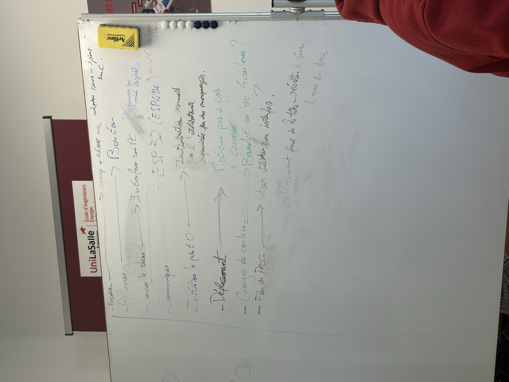

# 2026-11-13 : gestion de projet, séance 3 (sous-systèmes et organisation)

**Séance :** gestion de projet · **Durée :** 3 h

Support de cours : [slides de la séance 3](https://doc.makerspace-amiens.fr/workshops/methodologie-de-projet/slides/seance-3-sous-systemes-organisation/)

## Ce qu'on a vu en cours

### Fonction ou solution ?

- Une **fonction** dit *ce que* la machine doit faire, une **solution** dit *comment* elle le fait.
- Une fonction s'écrit **verbe + complément** (« déplacer le stylo », « changer de couleur »), sans nommer de composant. « Moteur pas à pas » est une solution, pas une fonction.
- Commencer par les fonctions évite de s'enfermer trop tôt dans une solution, et permet de comparer plusieurs solutions pour une même fonction.

### « Choisir, c'est renoncer »

- Pour chaque fonction, il y a plusieurs solutions possibles. En choisir une, c'est accepter d'abandonner les autres (et leurs avantages).
- Il faut donc trancher en équipe, justifier le choix, et l'écrire pour ne pas revenir dessus à chaque séance.

### Les interfaces

- Une **interface**, c'est ce qui relie deux sous-systèmes : une fixation mécanique, un câble, un signal, un format de fichier…
- Chaque interface doit avoir un **responsable**, sinon chacun suppose que c'est l'autre qui s'en occupe. C'est souvent là que les projets cassent au moment de l'assemblage.

### Le diagramme FAST

- Le **FAST** (*Function Analysis System Technique*) part de la fonction principale et la décompose de gauche à droite : on lit « **pourquoi ?** » vers la gauche et « **comment ?** » vers la droite.
- Au bout de chaque branche, on arrive aux **solutions techniques** retenues.

### Découper le système en 4 étapes

1. **Scénario d'usage** : raconter une utilisation complète de la machine, du début à la fin.
2. **Verbes** : relever tous les verbes du scénario, ce sont les fonctions.
3. **Blocs** : regrouper ces fonctions en **4 à 7 blocs** (sous-systèmes).
4. **Liens** : dessiner les liens entre les blocs, ce sont les interfaces.

### Les blocs souvent oubliés

- **L'alimentation** (d'où vient l'énergie, quelle tension pour quel composant).
- **Le support** (le cadre, la structure qui tient tout le reste).
- **La commande utilisateur** (comment on démarre, on arrête, on lance un dessin).

## Notre travail en équipe

On a listé au tableau les fonctions de la machine et une première solution pour chacune :

| Fonction | Solution envisagée |
|---|---|
| Fixer (le stylo / la tête) | Clipsage + alésage, avec un mécanisme servo / joint |
| Allumer | Bouton |
| Concevoir le slicer | Interface sur PC : programmer un mini logiciel |
| Communiquer | ESP32 (ESP-NOW) |
| Initialiser le point 0 | Initialisation manuelle par l'utilisateur, guidée par des marquages |
| Se déplacer | Moteurs pas à pas + courroies |
| Changer de couleur | Barillet ou stylo 4 couleurs ? |
| Terminer le programme | Retour à l'utilisateur sur l'interface ? Placement final de la tête pour ne pas gêner la vue du dessin |

## Pistes pour aller plus loin

- **Fonctions manquantes** par rapport aux blocs souvent oubliés :
  - *alimenter* la machine (moteurs, ESP32, servo : quelle alimentation, quelles tensions ?) ;
  - *supporter* l'ensemble (le cadre et le plateau, c'est ma partie mécanique) ;
  - *tenir la feuille* sur le plateau ;
  - *lever / poser le stylo* (sinon la machine dessine aussi pendant les déplacements) ;
  - *arrêter en urgence* ou mettre en pause.
- **Reformuler en verbe + complément** certaines lignes du tableau : « Fixation » → « fixer le stylo sur le chariot », « Déplacement » → « déplacer le stylo en X et Y », « Fin de prog » → « signaler la fin du dessin ».
- **Interfaces à définir, avec un responsable** :
  - chariot ↔ porte-stylo (fixation, poids, encombrement) : entre moi (mécanique) et Mathéo ;
  - moteurs ↔ carte électronique (drivers, câblage, alimentation) ;
  - PC ↔ machine (format des données envoyées par le slicer, liaison ESP-NOW).
- **Arbitrages à faire** (« choisir, c'est renoncer ») :
  - changement de couleur : **barillet** (plus de couleurs, mais un mécanisme de plus à concevoir) ou **stylo 4 couleurs** (déjà décidé en séance 3 planifiée, plus simple mais limité à 4 couleurs) ;
  - point 0 : initialisation **manuelle** (simple, pas de capteur) ou **capteurs de fin de course** (plus fiable et répétable, mais du câblage en plus).

## Reste à faire (pour la prochaine séance)

- `conception/index.md` : rédiger la section **Architecture globale** (blocs + liens).
- `objectifs.md` : mettre à jour les objectifs du projet.
- `equipe.md` : préciser qui est responsable de quel bloc et de quelle interface.
- `etudes.md` : compléter les études et comparaisons de solutions.
