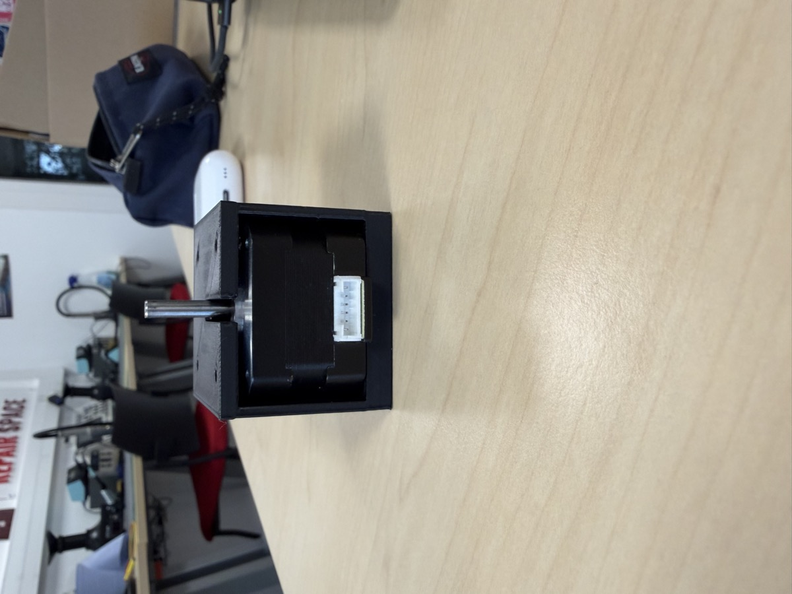
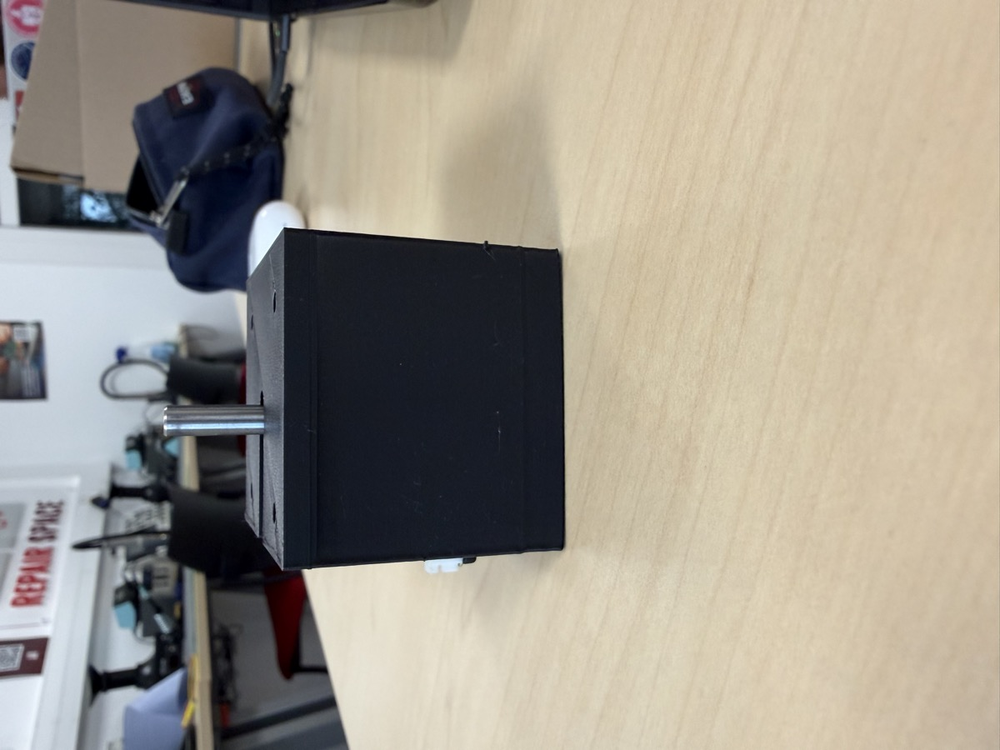

# 2026-11-06 : poulies et support moteur

**Séance :** planifiée · **Durée :** 3 h

## Fait

- **Recomptage des poulies** sur l'assemblage, comme Adrien Bracq me l'avait conseillé : il nous faut **6 poulies folles** et **2 poulies sur les moteurs**.
- **Impression d'un support moteur** et test sur le moteur : tout est bon, sauf les **trous du haut, qui ne sont pas alignés** avec ceux du moteur.
- Correction du modèle 3D, à réimprimer pour la prochaine fois.

## Pourquoi

- Le nombre exact de poulies était nécessaire pour pouvoir les demander.

## Reste à faire

- Réimprimer le support moteur corrigé et vérifier que tous les trous s'alignent avec le moteur.
- Demander les poulies.
