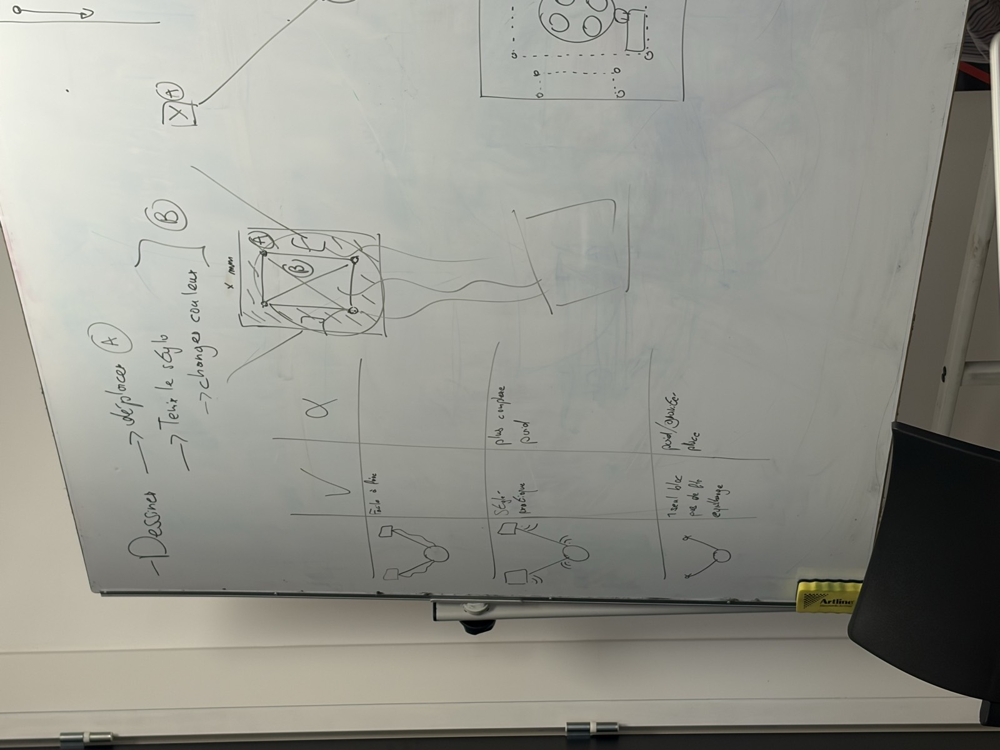
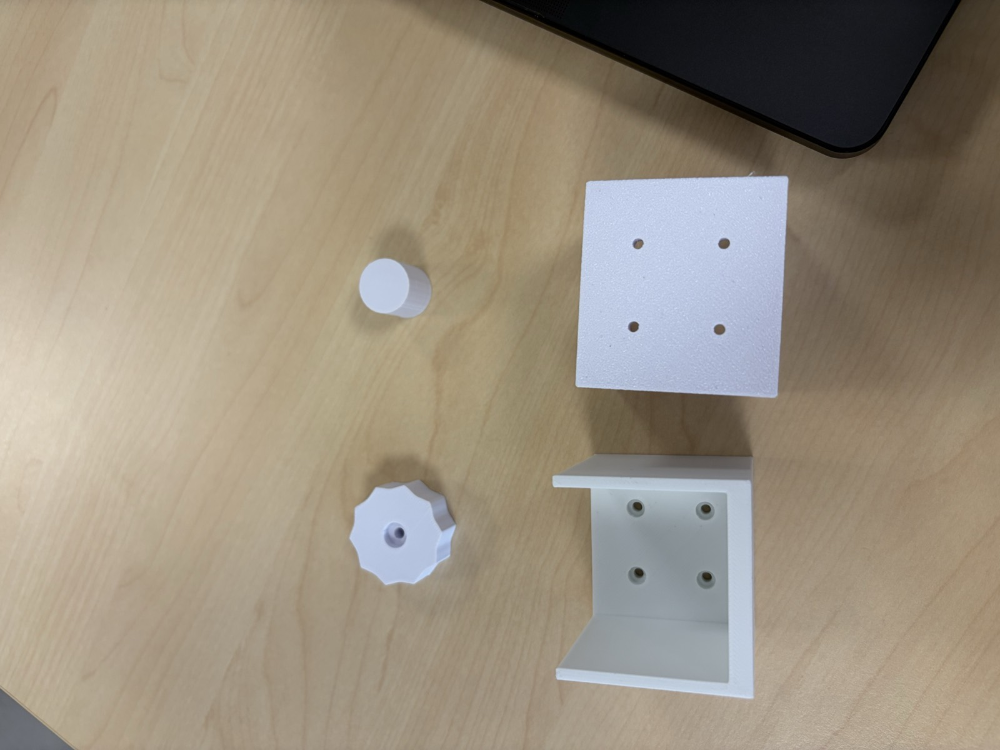
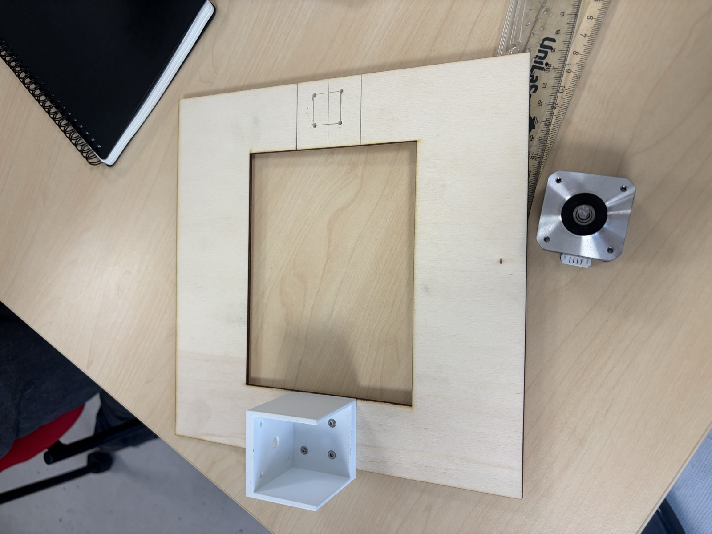
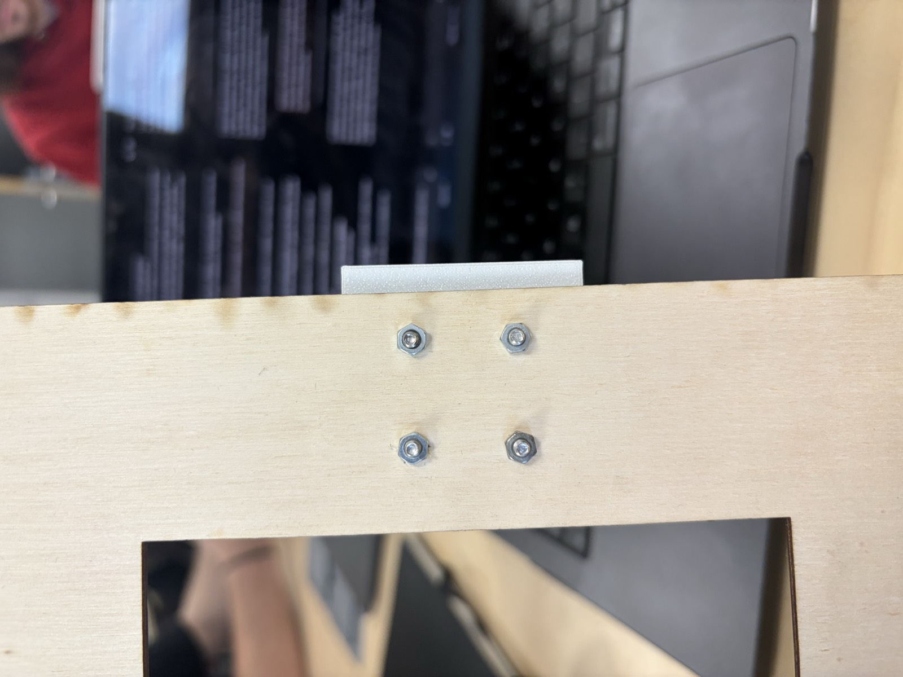

# 2026-11-20 : architectures du draw wall et calcul des moteurs

**Séance :** projet · **Date :** vendredi 20/11/2026

## Ce qu'on a fait

On est partis sur un **draw wall** (tableau vertical) : la nacelle qui porte le stylo est suspendue par deux câbles et se déplace sur le tableau. On a fait un brainstorm au tableau pour comparer trois architectures, puis j'ai fait les calculs pour vérifier que les moteurs NEMA 17 tiennent la charge.

### Découpage fonctionnel (rappel au tableau)

- **Dessiner** → **déplacer** (bloc A : moteurs, câbles/courroies) ;
- **Dessiner** → **tenir le stylo** et **changer de couleur** (bloc B : la nacelle, avec un barillet de stylos esquissé sur le côté).

### Les trois architectures comparées

| Architecture | Avantages | Inconvénients |
|---|---|---|
| **1.** Supports moteurs en haut du tableau, la nacelle communique avec l'électronique **par câbles** | Facile à faire | Les fils pendent jusqu'à la nacelle |
| **2.** Même chose **sans câbles** : communication entre **3 ESP32** (un par moteur + un sur la nacelle) | Style, pratique | Plus complexe, plus de poids (ESP32 + batterie sur la nacelle) |
| **3.** **Tout regroupé au même endroit** sur le draw wall : moteurs, électronique et stylo sur la nacelle | Un seul bloc, pas de fils, plus simple à équilibrer | Poids / gravité, place sur la nacelle |

Pour l'option 3, le groupe pèse en ce moment **tous les composants à la balance** pour connaître le poids total et vérifier que les moteurs tiennent.

### Support moteur NEMA 17 centré

Le nouveau support moteur NEMA 17 **centré** est en impression :

- perçage central **Ø 22,5 mm** pour le centrage du moteur, porté à **Ø 23 mm** en impression 3D (jeu pour la tolérance de l'imprimante) ;
- **4 trous Ø 3,4 mm** pour les vis M3, en carré de **31 mm** d'entraxe.

## Calculs : est-ce que les moteurs tiennent ?

Hypothèses : NEMA 17 avec un **couple de maintien de 0,4 N·m**, g = 9,81 m/s².

Formules : **F = C / r** (force au bout du rayon r) et **m = F / g** (masse équivalente).

### Avec une poulie GT2 20 dents (r ≈ 6,4 mm)

| Cas | Couple | Force | Masse équivalente |
|---|---|---|---|
| À l'arrêt (couple de maintien) | 0,4 N·m | 0,4 / 0,0064 ≈ **62 N** | ≈ 6,3 kg |
| En mouvement (~30 % du couple) | 0,12 N·m | 0,12 / 0,0064 ≈ **19 N** | ≈ 1,9 kg |
| En mouvement, coefficient de sécurité 2 | 0,06 N·m | ≈ **9 N** | ≈ 1 kg |

Le couple d'un pas à pas chute quand la vitesse augmente, d'où les ~30 % retenus en mouvement. On garde **≈ 9 N par moteur** comme force admissible.

### Avec un bras de 5 cm (pour comparer)

- À l'arrêt : 0,4 / 0,05 = **8 N** (0,82 kg) ;
- En mouvement : ≈ 2,4 N (≈ 245 g) ;
- Avec la sécurité : ≈ 1,2 N (≈ 120 g).

Plus le rayon est grand, moins le moteur peut tirer : c'est pour ça qu'on garde une petite poulie.

### Et avec 2 moteurs ?

- Chaque moteur travaille sur son propre axe : les couples **ne s'additionnent pas**.
- Si les deux moteurs tiraient la même charge dans la même direction, la force admissible doublerait.
- Sur un draw wall, chaque câble porte **une partie du poids** de la nacelle, selon l'angle des câbles.

### Estimation du poids de la nacelle (options 1 et 2)

| Élément | Masse |
|---|---|
| Structure en PLA | 60 g |
| Servo SG90 (lever le stylo) | 10 g |
| Stylo | 10 g |
| ESP32 + câbles | 20 g |
| Batterie | 90 g |
| **Total** | **≈ 190 g**, arrondi à **250 g** |

Soit un poids **P ≈ 2,5 N**.

### Bilan des forces à l'équilibre

La nacelle est immobile, suspendue par deux câbles qui font chacun un angle θ avec l'horizontale (nacelle au milieu du tableau, cas symétrique) :

- horizontalement : T₁ cos θ = T₂ cos θ, donc T₁ = T₂ = T ;
- verticalement : 2 T sin θ = P, donc **T = P / (2 sin θ)**.

| Angle θ | Tension par câble (P = 2,5 N) |
|---|---|
| 45° | ≈ **1,8 N** |
| 15° | ≈ **4,8 N** |
| 10° | ≈ **7,2 N** |

Plus la nacelle monte, plus les câbles se rapprochent de l'horizontale et plus la tension explose. Ça reste sous les **≈ 9 N admissibles**, sauf tout en haut du tableau : il faudra **éviter la bande supérieure** de la zone de dessin.

### Option 3 : moteurs sur la nacelle

Si les moteurs sont aussi sur la nacelle, on ajoute 2 × ~280 g, soit une nacelle d'environ **800 g** (P ≈ 7,8 N). Les tensions sont multipliées par environ **3,2** :

- à 45° : ≈ **5,7 N** ;
- à 15° : ≈ **15 N**, au-dessus des 9 N admissibles.

Ça devient **limite près du haut** du tableau. Le poids réel mesuré à la balance tranchera.

## Mesure à la balance (option 3)

On a pesé tous les composants de l'option 3 : **824 g**, sans la structure elle-même. En estimant la structure à environ **180 g**, on arrive à environ **1 kg** au total, soit **P ≈ 9,8 N**.

Avec T = P / (2 sin θ) :

| Angle θ | Tension par câble (P ≈ 9,8 N) | Verdict |
|---|---|---|
| 45° | ≈ **7 N** | OK |
| 33° | ≈ **9 N** | Limite (force admissible avec la sécurité de 2) |
| 15° | ≈ **19 N** | Maximum du moteur en mouvement : décrochage probable |

**Conclusion :** l'option 3 est viable si les câbles restent **au-dessus de 33°** par rapport à l'horizontale. Il faut donc **éviter le tiers haut du tableau**, ou **alléger la nacelle** (mettre la batterie sur le cadre, imprimer avec un remplissage plus faible).

## Décision : on part sur l'option 3

Après la pesée, le groupe a choisi l'**option 3** : tout regroupé sur la nacelle (moteurs, électronique, stylo). Il y a donc beaucoup de pièces à modéliser.

## Premier assemblage : plaque et support moteur

Le support moteur NEMA 17 centré est sorti de l'impression, avec d'autres pièces imprimées en 3D.

Ensuite :

1. **Découpe laser** d'une plaque carrée en contreplaqué, avec une ouverture rectangulaire au centre.
2. **Traçage et perçage** des 4 trous de fixation du support dans la plaque (carré tracé au crayon pour positionner les trous).
3. **Vissage** du support sur la plaque avec **4 vis M3 de 12 mm** et **4 écrous**.

## Reste à faire

- Peser la **structure réelle** une fois imprimée et refaire le calcul avec le poids exact.
- **Modéliser les pièces** de la nacelle pour l'option 3 (supports des deux moteurs, emplacement de l'électronique et de la batterie, porte-stylo).
- Monter le **NEMA 17** dans le support (centrage Ø 23 mm, entraxe 31 mm) et vérifier qu'il tient bien.
- Vérifier la **valeur réelle du couple de maintien** dans la fiche technique de nos moteurs (0,4 N·m est une hypothèse).
- Définir la **zone de dessin utile** (câbles au-dessus de 33° par rapport à l'horizontale si on part sur l'option 3).
